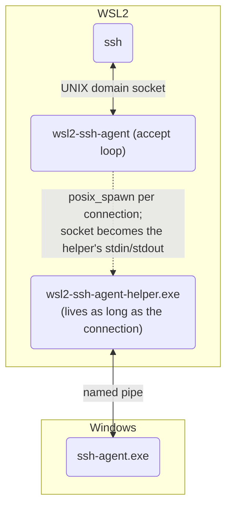

# wsl2-ssh-agent

This tool lets WSL2 use the ssh-agent service on the Windows host
(Windows OpenSSH `ssh-agent.exe`, or any agent on a named pipe such as pageant).

This is a low-resource re-implementation of
[mame/wsl2-ssh-agent](https://github.com/mame/wsl2-ssh-agent) by Yusuke Endoh
(MIT license, kept in [LICENSE](LICENSE)): a small C daemon in WSL2 plus a
~6.5 KB native Windows helper that is started only while a client is
connected. Nothing stays resident on the Windows side, and the daemon makes no
wakeups while idle. Command-line flags and shell integration are compatible
with the original. See [DESIGN.md](DESIGN.md) for the analysis, the
alternatives that were measured, and the benchmarks.

## How to use

Requirements: WSL2 with Windows interop enabled (the default), and the
"OpenSSH Authentication Agent" service running on Windows.

### 1. Install

#### Option A: download a release

The binary is a single file; the Windows helper is embedded in it.

```sh
cd ~
# x86-64
curl -LO https://github.com/Ray05202006/wsl2-ssh-agent/releases/latest/download/wsl2-ssh-agent
# ARM64 (see the note below)
curl -LO https://github.com/Ray05202006/wsl2-ssh-agent/releases/latest/download/wsl2-ssh-agent-arm64

# verify (prints "OK" for each file you downloaded)
curl -LO https://github.com/Ray05202006/wsl2-ssh-agent/releases/latest/download/checksums.txt
sha256sum -c --ignore-missing checksums.txt

chmod 755 wsl2-ssh-agent*
```

The examples below assume `/usr/bin/wsl2-ssh-agent`; use `$HOME/wsl2-ssh-agent`
instead if you keep it in your home directory (or `sudo install -m 755
wsl2-ssh-agent /usr/bin/`). On ARM64, rename `wsl2-ssh-agent-arm64` to
`wsl2-ssh-agent` or use that name below.

**ARM64 note:** only the Linux side is built for ARM64. The embedded Windows
helper is x86-64 and relies on Windows on ARM's x64 emulation. The ARM64
build is compiled in CI but has **not been tested on ARM hardware yet**.

#### Option B: build from source

```sh
# Arch Linux (WSL2)
sudo pacman -S --needed base-devel mingw-w64-gcc
make WINCC=x86_64-w64-mingw32-gcc
sudo make install PREFIX=/usr        # -> /usr/bin/wsl2-ssh-agent
```

If you prefer not to install mingw-w64 and you have Visual Studio (or the Build
Tools) installed on the Windows host, `make` builds the helper with the
host's MSVC through WSL interop (`windows/msvc.sh`). You can also build the
helper anywhere else and pass `make HELPER_EXE=/path/to/wsl2-ssh-agent-helper.exe`.

#### Where the helper goes

On start, the daemon writes the embedded helper to
`$XDG_RUNTIME_DIR/wsl2-ssh-agent/` (or `~/.cache/wsl2-ssh-agent/`). The file is
mode 0700, sits in an owner-only directory, and is rewritten only if its
content differs. Nothing is installed on the Windows side.

### 2. Modify your shell's rc file

#### bash or zsh

Add the following line to `.bashrc` (or `.zshrc` if you are using `zsh`).

```
eval $(/usr/bin/wsl2-ssh-agent)
```

#### fish

Add the following lines to `config.fish`

```
if status is-login
  /usr/bin/wsl2-ssh-agent | source
end
```

### 3. Systemd service (optional)

We also provide a [systemd service](extras/systemd/user/wsl2-ssh-agent.service). You can use it to automatically start `wsl2-ssh-agent` when you log in to WSL2. But if you are already using your shell's rc file to start `wsl2-ssh-agent`, you can safely skip this step.

* Copy the provided [`wsl2-ssh-agent.service`](extras/systemd/user/wsl2-ssh-agent.service) file to `~/.config/systemd/user/` (`make install PREFIX=/usr` already puts it in `/usr/lib/systemd/user/`).

* Enable and start the service:

  ```sh
  systemctl --user enable --now wsl2-ssh-agent.service
  ```

* Add the following to your shell's rc file (e.g., `.bashrc`, `.zshrc`):

  ```sh
  export SSH_AUTH_SOCK=$XDG_RUNTIME_DIR/wsl2-ssh-agent.sock
  ```

### 4. Reopen your terminal

Close and reopen the terminal.
You should now be able to run `ssh your-server` and connect using the SSH keys managed by the Windows ssh-agent.exe service.

## Options

```
-socket PATH     UNIX domain socket to listen on (default ~/.ssh/wsl2-ssh-agent.sock)
-pipename NAME   Windows named pipe to connect to (default openssh-ssh-agent)
-helper PATH     use this wsl2-ssh-agent-helper.exe instead of the embedded one
-prespawn        keep one helper started ahead of time (lower connection
                 latency, ~1 MB resident on Windows; see below)
-foreground      run in foreground mode
-verbose         verbose mode
-log FILE        append the log to FILE
-format FMT      output format: auto, bash, zsh, csh, tcsh, or fish (default auto)
-stop            stop the running daemon and exit
-version         print version and exit
```

Flags may be written `-flag`, `--flag`, `-flag=value` or `-flag value`, the same
as the original Go version. `-powershell-path` is still accepted and ignored,
because PowerShell is no longer used.

## Tip: Using with pageant.exe

If you want to use the named pipe provided by pageant.exe, you can use the `-pipename` option.
For example:

```
eval $($HOME/wsl2-ssh-agent -pipename $(grep -oP "IdentityAgent \"//\./pipe/\K[^\"]+" /mnt/c/.../pageant.conf))
```

## Troubleshooting

### Confirm ssh-agent.exe is working

* Open the "Services" app on Windows and confirm the "OpenSSH Authentication Agent" service is installed and running.
* Check that `ssh your-server` works from cmd.exe or PowerShell (i.e., outside of WSL2).

### Check the wsl2-ssh-agent log

```
$ wsl2-ssh-agent -stop
$ wsl2-ssh-agent -verbose -foreground
[L] 2026/11/08 22:42:49 start listening on /home/you/.ssh/wsl2-ssh-agent.sock
[L] 2026/11/08 22:42:50 ssh: connected (helper pid 588042, 1 active)
```

Errors from the Windows helper are prefixed with `[W]`, for example
`[W] cannot connect to the agent's named pipe (is the ssh-agent service running?): error 2`.

### Tests

```
make test-daemon   # Linux-side tests with a stand-in helper (runs anywhere)
make test          # end-to-end tests against the real Windows agent (WSL2 only)
make sanitize fuzz valgrind analyze   # memory-safety checks (see DESIGN.md §10)
```

## How It Works



* `wsl2-ssh-agent` listens on a UNIX domain socket in WSL2 (mode 0600).
* For each client connection, it starts `wsl2-ssh-agent-helper.exe` through WSL
  interop, with the accepted socket as the helper's stdin and stdout. The daemon
  then closes its copy and goes back to waiting. It never reads agent traffic.
* The helper opens its own connection to the agent's named pipe. It relays
  length-framed agent messages (rejecting malformed frames and anything over
  256 KiB) and exits when the client disconnects.

Each client gets its own pipe connection. Per-connection agent state therefore
behaves exactly as it does on Windows, concurrent clients never wait for each
other, and a restarted Windows agent is picked up by the next connection.

The trade-off is about 40 ms of WSL interop process start-up per *connection*,
not per request. See DESIGN.md for the numbers.

### `-prespawn`: warm standby (opt-in)

With `-prespawn`, the daemon keeps one helper already started, waiting on a
socketpair. A new client is handed to that standby: a small forked relay
copies bytes between the client and the helper, and the next standby starts
right away. Connection set-up then skips the interop start, at the cost of one
resident helper process (a few hundred KB private on each side; numbers in
DESIGN.md §9). The standby doesn't open the agent's pipe until its first
request, so an agent restart while it waits does no harm. If the helper keeps
failing to start, the daemon backs off and falls back to the default
per-connection path.

## Note on Windows OpenSSH Compatibility

The newer SSH client (version 8.9+) sends an extended protocol message
(`SSH_AGENTC_EXTENSION`, for session-bind) that older Windows agents (before
8.9) don't understand. When the helper receives such a message, it checks the
version of `ssh-agent.exe` on the Windows `PATH`, once per connection and only
when an extension message actually arrives. If the agent is older than 8.9, or
if it can't be found (as with pageant), the helper answers `SSH_AGENT_FAILURE`
itself. Clients treat that as "extension not supported", so the connection
keeps working.

The original sent `SSH_AGENT_SUCCESS` here. `FAILURE` is the reply the
protocol defines for an unsupported extension, and OpenSSH continues normally
on either reply.
